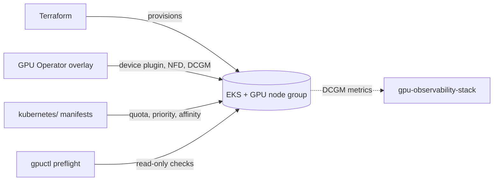

# gpu-kubernetes-platform

A reproducible, GPU-aware Kubernetes reference on AWS EKS. It provisions a
cluster with a dedicated GPU node group, installs the NVIDIA GPU Operator with
a deliberate driver-ownership split, applies scheduling controls that keep
accelerators from being wasted, and ships a read-only Python CLI (`gpuctl`)
that tells you — honestly — whether the cluster can actually run GPU workloads.

It is the infrastructure foundation for two companion projects:
[`gpu-scheduler-capacity-lab`](https://github.com/jedi132000/gpu-scheduler-capacity-lab)
(offline scheduling/capacity simulation) and
[`gpu-observability-stack`](https://github.com/jedi132000/gpu-observability-stack)
(DCGM/Prometheus/Grafana telemetry).

## Problem it solves

Two failure modes dominate early GPU-on-Kubernetes work:

1. **Invisible GPUs** — nodes have accelerators but `nvidia.com/gpu` never
   becomes allocatable because the driver and device plugin disagree about who
   owns what.
2. **Wasted GPUs** — ordinary pods land on expensive GPU nodes because the
   nodes aren't dedicated, or GPU pods sit Pending because they lack the right
   toleration/affinity.

This repo takes an explicit position on both (see
[ADR 0001](docs/adr/0001-gpu-scheduling-and-operator-ownership.md)) and gives
you a CLI that detects them.

## What's here

| Path                 | Purpose                                                        |
| -------------------- | -------------------------------------------------------------- |
| `terraform/`         | EKS + VPC + GPU/CPU node groups (upstream modules, pinned)     |
| `helm/gpu-operator/` | GPU Operator values overlay (AMI owns driver; operator owns plugin/DCGM) |
| `kubernetes/`        | Scheduling model: quota, priority, GPU validation job, CPU demo, a pending-pod example |
| `src/gpuctl/`        | Read-only preflight/validation CLI                             |
| `tests/`             | Unit, CLI, and manifest-invariant tests                        |
| `docs/`              | Architecture, quickstart, troubleshooting, runbooks, ADR, metadata |

## Architecture



Full diagrams in [docs/architecture.md](docs/architecture.md).

## Why these technologies

- **Upstream Terraform modules** (`terraform-aws-modules/eks`, `/vpc`) instead
  of hand-rolled control-plane/networking: less surface area to get wrong, and
  they track EKS changes. We own only the GPU-specific node group config.
- **AWS GPU-optimized AMI owns the driver**, GPU Operator owns the device
  plugin, NFD, and DCGM. One driver, one owner — avoids the most common
  "0 allocatable GPUs" failure. Rationale and the alternative in ADR 0001.
- **Device-plugin whole-GPU scheduling** (not DRA) for broad EKS compatibility;
  DRA and MIG are documented as gated future paths.
- **Typer CLI with a pure-function core** so the full matrix of cluster states
  is unit-tested without a live cluster.

## Quickstart

No GPU? Use the CPU-only path to exercise the model on kind/minikube:

```bash
pip install -e '.[cluster]'
kubectl apply -f kubernetes/scheduling/00-namespace-quota.yaml
kubectl apply -f kubernetes/scheduling/01-priorityclasses.yaml
kubectl apply -f kubernetes/cpu-demo/cpu-workload.yaml
gpuctl preflight      # -> state: no_gpu_nodes (exit 2)
```

Full GPU-on-EKS path (incurs cost) and teardown: see
[docs/quickstart.md](docs/quickstart.md).

## Validation

```bash
# Python
pip install -e '.[dev]'
pytest -q && ruff check src tests && mypy

# Infra / manifests
terraform -chdir=terraform fmt -check -recursive
terraform -chdir=terraform validate            # after: terraform init -backend=false
helm template gpu-operator nvidia/gpu-operator --version v25.3.4 \
  -f helm/gpu-operator/values.yaml
kubeconform -strict kubernetes/
```

Recorded results and versions: [docs/evidence.md](docs/evidence.md).

## Compatibility

| Component    | Tested / targeted            |
| ------------ | ---------------------------- |
| Kubernetes   | 1.28 – 1.31 (EKS)            |
| GPU Operator | v25.3.4                      |
| GPU nodes    | `g5.xlarge` (A10G); any NVIDIA node via AMI |
| Python       | 3.10 – 3.13                  |
| Terraform    | 1.6+                         |

## Limitations

- No live GPU hardware was used to build this; the GPU validation Job and the
  `gpu_ready` path are verified by unit tests and schema validation, **not** on
  a physical GPU. The CLI reports hardware state honestly rather than assuming.
- `terraform apply` is not run by this repo or its CI; no cloud resources are
  created without your explicit action.
- MIG and DRA are documented, not enabled by default.

## Related repositories

- [gpu-scheduler-capacity-lab](https://github.com/jedi132000/gpu-scheduler-capacity-lab) — model placement/capacity offline using these workload specs.
- [gpu-observability-stack](https://github.com/jedi132000/gpu-observability-stack) — scrape and visualise the DCGM telemetry this platform emits.

## License

Apache-2.0 — see [LICENSE](LICENSE).
