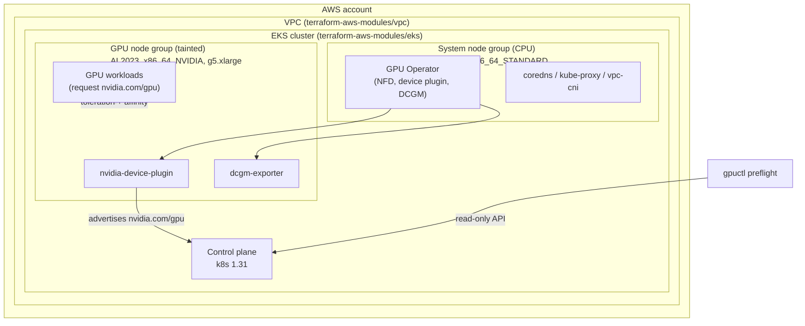
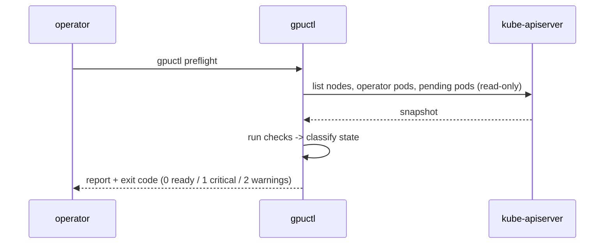

# Architecture

## Components

## Scheduling model

- GPU nodes are **dedicated** via a `nvidia.com/gpu=present:NoSchedule` taint.
  Only pods with a matching toleration land on them.
- GPU nodes are **labelled** `nvidia.com/gpu.present=true` (by the node group
  and by Node Feature Discovery). GPU workloads use required node affinity on
  this label.
- The NVIDIA **device plugin** advertises `nvidia.com/gpu` as an integer
  resource. Pods request whole GPUs; GPUs cannot be overcommitted.
- A namespace **ResourceQuota** caps GPUs per tenant; a **LimitRange** supplies
  a default GPU request so malformed pods are rejected.
- **PriorityClasses** let inference serving preempt batch training when the GPU
  pool is contended.

See [adr/0001](adr/0001-gpu-scheduling-and-operator-ownership.md) for why this
model (and the AMI-owns-driver split) was chosen.

## Preflight flow

`gpuctl` classifies the cluster into one of: `unreachable`, `no_gpu_nodes`
(CPU-only), `missing_operator`, `unhealthy_gpu`, or `gpu_ready`.

## Component boundaries

| Concern                         | Owner                              |
| ------------------------------- | ---------------------------------- |
| VPC, subnets, IAM, EKS, nodes   | Terraform (`terraform/`)           |
| NVIDIA driver + container runtime | GPU node AMI                     |
| device plugin, NFD, DCGM        | GPU Operator (`helm/gpu-operator`) |
| quotas, priority, placement     | manifests (`kubernetes/`)          |
| validation / diagnostics        | `gpuctl` (`src/gpuctl`)            |
| telemetry dashboards + alerts   | companion `gpu-observability-stack` |
